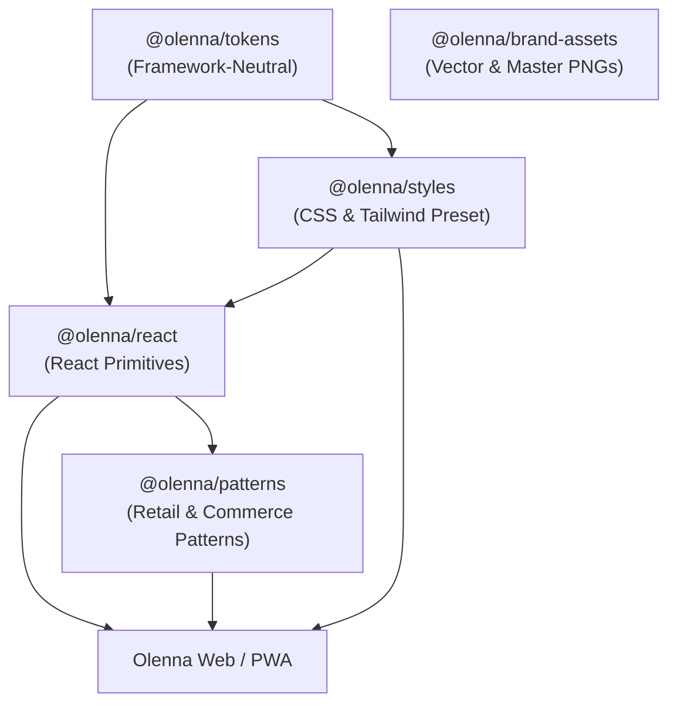

# Architecture & Principles

The Olenna StudioX Design Language System is engineered according to fifteen core principles to ensure longevity, developer velocity, and uncompromising aesthetic rigor.

## Core Architectural Principles

1. **Simplicity before abstraction**: Avoid premature layers of indirection. Prefer clear, composable React and CSS primitives.
2. **Stable public APIs**: Strict TypeScript contracts with explicit prop interfaces and semantic version guarantees.
3. **Framework-independent design tokens**: Tokens originate in platform-neutral JSON files (`tokens.json`), generating CSS variables and typed constants. Non-React consumers never need to install React.
4. **Reusable and accessible components**: Built to meet **WCAG 2.2 AA** guidelines out of the box, with full keyboard navigation and ARIA attributes.
5. **Clear separation of concerns**:
   - `@olenna/brand-assets`: Logos, emblems, SVGs, color specifications.
   - `@olenna/tokens`: Design tokens and CSS custom properties.
   - `@olenna/styles`: CSS stylesheets and Tailwind preset.
   - `@olenna/react`: Framework-specific generic UI components.
   - `@olenna/patterns`: Olenna retail, boutique discovery, and PWA patterns.
6. **No hardcoded application business logic**: Generic UI components and patterns never import application-specific services, authentication endpoints, or payment gateways.
7. **Progressive adoption**: Consumers can install only the token package, the styles package, the core React package, or the full pattern suite without forced lock-in.
8. **Backward compatibility**: No undocumented breaking changes. Deprecation occurs with phased warnings and migration paths.

---

## Monorepo Dependency Graph

