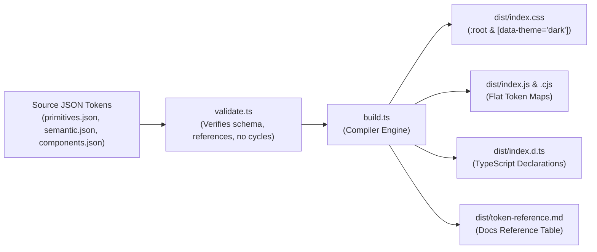

# Design Tokens Overview

Design tokens represent the atomic visual decisions of Olenna StudioX: colors, font families, font sizes, line heights, spacing increments, radii, elevations, motion, and z-index layers.

## Source & Generation Pipeline



## Token Taxonomy

Tokens follow a predictable, hierarchical naming convention:

```text
--olenna-[category]-[element]-[variant]-[state]
```

Examples:
- `--olenna-color-brand-plum-900`
- `--olenna-color-text-primary`
- `--olenna-color-surface-card`
- `--olenna-color-action-primary-default`
- `--olenna-color-action-primary-hover`
- `--olenna-spacing-4`
- `--olenna-border-radius-md`
- `--olenna-shadow-lg`
- `--olenna-zIndex-modal`
